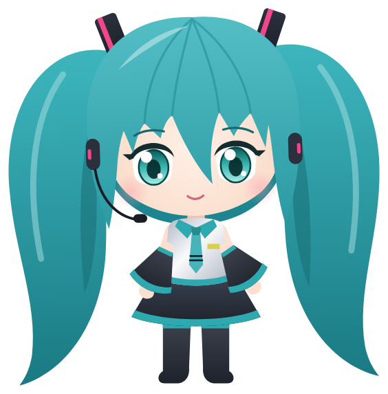
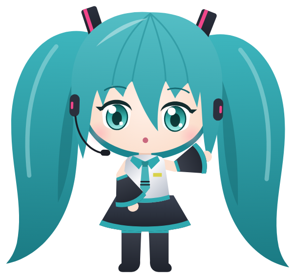
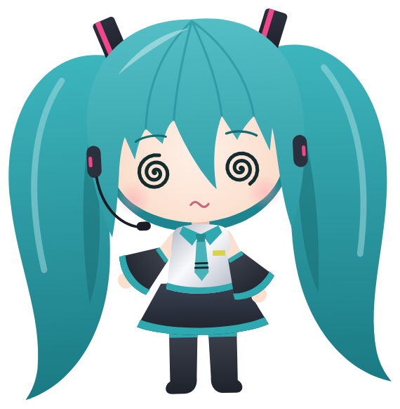
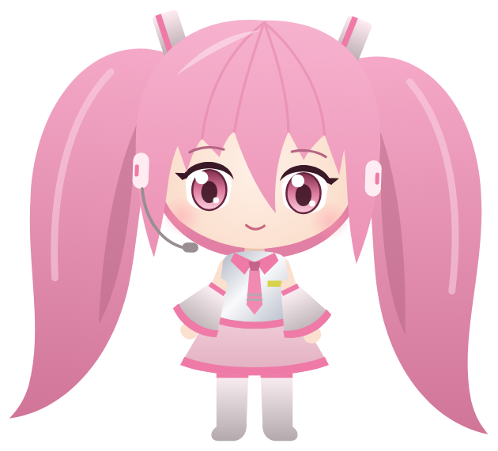

<div align="center">



# Miku

**Hatsune Miku lives at the top of your screen and keeps an eye on your AI coding agents, on Windows and Linux.**

Approve permissions, watch your agents work, drop a file, chat with Claude, dictate anywhere, all without leaving what you're doing. Miku sings, dances to your music and waves when you come back.

[](https://github.com/FinDArata/Miku/releases)


</div>

---

## Meet Miku

Miku is a chibi **drawn entirely in code**: no sprites, no images, no Live2D. A canvas engine draws her twin-tails, headset, tie and blinking eyes at 60 fps. She follows your cursor with her eyes, bobs to the beat, gets annoyed when you poke her (and dizzy if you insist), and tells you the moment Claude Code needs you.

### She shows you what your agents are doing

<table>
<tr>
<td align="center"><br><sub>working</sub></td>
<td align="center"><br><sub>needs your OK</sub></td>
<td align="center"><br><sub>done!</sub></td>
<td align="center"><br><sub>nothing running</sub></td>
<td align="center"><br><sub>poked three times</sub></td>
</tr>
</table>

### A live stage when you start

When Miku launches, the footlights come on from left to right, a spotlight falls on her mark, and she rises through the stage floor, waves to the crowd (or bows, or twirls: a different hello each day) and watches her name light up karaoke-style. Then she settles in the island.

<table>
<tr>
<td></td>
<td></td>
</tr>
</table>

## Themes

She comes in her three official looks, and **each look is a theme for the whole app**. Pick one in the wardrobe (right-click Miku, or the Wardrobe page in the Miku window), or let the season choose: Snow in winter, Sakura in spring.

<table>
<tr>
<td align="center" width="33%"><br><b>Miku</b><br><sub>teal twin-tails, notes around her</sub></td>
<td align="center" width="33%"><br><b>Snow Miku</b><br><sub>falling snowflakes</sub></td>
<td align="center" width="33%"><br><b>Sakura Miku</b><br><sub>falling petals</sub></td>
</tr>
</table>

The theme's accent is her tie colour, straight from her palette, so Miku and the interface always agree. It paints the island's stage light and footlights, the tabs, the buttons, the dictation pill and the Miku window, and fades from one colour to the next instead of snapping. Hovering a look in the Wardrobe page tries it on every window; only a click keeps it.

## The island

One island at the top of your screen, changing shape with what's going on:

- **Closed: the synth strip.** A small capsule with Miku's head and the time (and the weather, once the Weather page has read it). While a song plays it shows the title and an equaliser. Click it to open the island; it never pops open just because the pointer passes by. Settings → General lets you show the date, your Claude usage, what's playing, an empty capsule, or nothing at all instead.
- **Something arrives: a notice.** A WhatsApp, LINE or Discord message, or an agent that finished, grows a card out of the capsule for a few seconds. Whatever you haven't seen yet hangs under the capsule: Miku on a thread holding a sign with the count.
- **A song plays: her stage.** Cover, title and artist, Miku singing under spotlights, three lines of synced lyrics (with rōmaji for Japanese and Korean), and *Detach lyrics* for a floating lyrics card.
- **Open: the widget deck.** A tab bar with **PC** (CPU, RAM, disk, network, the busiest program), **Music**, **Focus** (a pomodoro), **Weather** (Open-Meteo, for a city you type), **Meeting** (Cal.com) and **Agents**, with Miku standing full-length beside each page.
- **An agent asks: the twin-tail card.** Allow / Deny / Always, or the choices of an `AskUserQuestion`. Fold it away with Escape and it keeps waiting under the capsule until you answer.

## Features

- 🤖 **Your agents, live**: Claude Code, Cursor, Codex, Gemini CLI, Antigravity, Copilot CLI, Muse Code, OpenCode, Amp, Hermes, ZCode, Claude Desktop and others. The Agents page shows the step each one is running and for how long, the end of what the last tool printed, Claude Code's task list, and every edit with its +N −M counts and the full diff a click away. Tag a hook payload with `miku_agent` to give any agent its own pill (see [`docs/AGENTS.md`](docs/AGENTS.md)).
- ✅ **Approve and answer from the island**: permission requests show up with **Allow / Deny / Always**, and `AskUserQuestion` prompts show their choices right there. Several requests wait their turn in a stack. Nothing is ever approved without your click.
- 💬 **Chat with Claude**: with your own API key, or **on the subscription you already pay for** through the official CLI (Claude Code, Antigravity, Gemini CLI, Codex, Cursor, Copilot, ZCode).
- 🎙️ **Flow dictation**: hold a key anywhere (right Ctrl by default), speak, let go: your words are pasted where you type. Runs offline with Parakeet; on Linux it works on X11 and Wayland.
- 🗣️ **« OK Miku »**: ask her things out loud, powered by Claude with your key.
- 🎵 **Music and lyrics**: Spotify and system media in the island, synced lyrics in the top pill (Japanese read as rōmaji), and Miku dances to the song itself.
- ✉️ **Mail** *(Windows, classic Outlook)*: search, filters, automatic sorting with rules and Undo, mail plans from the chat that run only when you click Run.
- 📎 **Drop a file on the island**: Miku swallows it, then ask Claude about it.
- 🔌 **Integrations**: GitHub, GitLab, Gitea, Vercel, Stripe, n8n, Resend, Notion, Cal.com, WhatsApp (experimental), each with its own pill.
- 💌 **LINE and Discord** *(Windows, off by default)*: their notifications show up in the island, read from the toasts Windows already shows. Nothing is sent or written anywhere.
- 🪟 **The Miku window**: opens on a main menu, sections as bubbles over Miku's head, with search across all settings. Closing it asks whether to keep Miku running in the tray or quit.
- 🖥️ **Miku on the desktop**: drag her out of the island and she floats on your desktop, follows your cursor, and flies home when something needs you.
- ⌨️ **Keyboard shortcuts** for everything, all customisable.
- 🔊 **30 sounds composed in code**, including Miku singing "mi-ku" when you change slides. Drop a file with the same name in the sounds folder to replace any of them.
- 🌍 **14 languages**, Bahasa Indonesia included.
- 🔒 **Private by design**: no telemetry, no account. Keys live in Windows Credential Manager or the Linux Secret Service. The app only talks to the services you plug in (and, once you agree, to GitHub's releases API to tell you about new versions).

## Install

### Windows

Download **[Miku-Windows.msi](https://github.com/FinDArata/Miku/releases/download/windows-latest/Miku-Windows.msi)** or **[Miku-Windows-setup.exe](https://github.com/FinDArata/Miku/releases/download/windows-latest/Miku-Windows-setup.exe)** (Windows 10/11, always the newest version) and run it.

**Windows will show a warning the first time.** The installer isn't code-signed yet, so SmartScreen shows *"Windows protected your PC"*. Click **More info**, then **Run anyway**.

Once you agree (the island asks once, or Settings → General → Updates), Miku tells you when a new version is out, and **Update now** downloads the installer, checks its SHA-256 against the one GitHub publishes and installs it in one click.

### Linux

x86_64 builds are on the [releases page](https://github.com/FinDArata/Miku/releases): AppImage, .deb and .rpm, with `SHA256SUMS`.

- **AppImage** (any distribution): `chmod +x Miku-Linux-*.AppImage`, then run it.
- **Debian / Ubuntu**: `sudo apt install ./Miku-Linux-*.deb`
- **Fedora / openSUSE**: `sudo dnf install ./Miku-Linux-*.rpm`
- **Arch**: build it with the [PKGBUILD](linux/arch/PKGBUILD).

The island sits on the top edge on compositors with layer-shell (COSMIC, KDE Plasma, Hyprland, Sway and other wlroots compositors). GNOME has no layer-shell, so there it runs through XWayland as a dock window at the top of the screen.

### Build from source

Requirements: [Rust](https://rustup.rs), Node 20+, and on Windows the MSVC build tools.

```bash
git clone https://github.com/FinDArata/Miku.git
cd Miku/windows
npm install
npm run tauri dev           # run it
npm run pack                # or build the installer into windows/release/
```

On Linux, install the WebKitGTK, gtk-layer-shell and appindicator development packages first (Debian/Ubuntu names):

```bash
sudo apt install build-essential pkg-config libwebkit2gtk-4.1-dev libgtk-layer-shell-dev libayatana-appindicator3-dev librsvg2-dev libssl-dev libdbus-1-dev patchelf gstreamer1.0-plugins-base gstreamer1.0-plugins-good
```

More in [`windows/README.md`](windows/README.md).

## Setup

Click the Miku icon in the system tray → **Settings…**

| Agent | How it connects |
|---|---|
| Claude Code | Settings → Claude Code → **Install hooks** (your `settings.json` is backed up and you see the diff before anything is written) |
| Gemini CLI, Antigravity, Codex | Settings → the agent → **Install hooks** |
| Cursor | Installed alongside Claude Code |
| Copilot CLI, Muse Code | `--agent copilot` / `--agent muse` flag |
| OpenCode, Amp, Hermes | Settings → the agent → **Install** (a plugin that starts the `miku-hook` relay) |
| ZCode | Settings → Agents → ZCode → **Install** |
| Any other | `--agent <name>` flag; see [`docs/AGENTS.md`](docs/AGENTS.md) |

Agents on a server can reach Miku through an SSH tunnel: see [`docs/REMOTE.md`](docs/REMOTE.md).

## Things to try

| Do this | Miku does that |
|---|---|
| Click the strip at the top of the screen | opens her stage |
| Press Escape | folds back to the strip |
| Hover Miku | blinks, eyes grow |
| Click Miku | squish + annoyed |
| Click 3 times fast | 😵‍💫 dizzy for a few seconds |
| Swipe or press ← / → on the overview | the next pill's slide, with a little "mi-ku" |
| Drag a file onto the island | swallows it |
| Right-click Miku | the wardrobe: classic, Snow or Sakura, and the theme with it |
| Hold right Ctrl and speak, in any app | your words are pasted |

## How it works

- A [Tauri 2](https://tauri.app) app (Rust + TypeScript). The island is a transparent, always-on-top window that never steals focus; on Wayland it is a gtk-layer-shell overlay.
- Miku is drawn in Canvas 2D by [`windows/src/mochi/engine.ts`](windows/src/mochi/engine.ts); her three looks are palettes in [`variants.ts`](windows/src/mochi/variants.ts). The app icon and every picture in this README are renders of that same engine.
- Agent hooks go through a tiny `miku-hook` relay, over the named pipe `\\.\pipe\miku-<sid>` on Windows or a Unix socket in `$XDG_RUNTIME_DIR` on Linux. If the app doesn't answer, the hook exits at once: Miku never blocks your agent.

## Contributing

Issues and PRs are welcome: new integrations, new emotes, new sounds, bug fixes. See [CONTRIBUTING.md](CONTRIBUTING.md). Add a string in English first, then translate it in `extra.json`.

## Credits

Miku is a fork of **[Coucou](https://github.com/Louis-CFM/coucou) by [Louis Raillé](https://louisraille.fr)**, who wrote the original app. This fork is maintained by [FinDArata](https://github.com/FinDArata) and rebuilt around Windows, Linux and Miku; the upstream macOS and iPhone apps are not part of it. The original project's history is in [docs/CHANGELOG-COUCOU.md](docs/CHANGELOG-COUCOU.md).

## License

- **Code:** [MIT](LICENSE).
- **Hatsune Miku** is © Crypton Future Media, INC., used under the [Piapro Character License](https://piapro.net/en_for_creators.html). This build is non-commercial and is not official, sponsored or endorsed by Crypton Future Media. The chibi here is drawn by this project's own code; no official artwork is included.
- **The upstream Coucou name and the Mochi character** remain © Louis Raillé.

Details in [LICENSE-ASSETS.md](LICENSE-ASSETS.md).

<div align="center">

**If Miku made you smile, a ⭐ helps a lot.**

</div>
