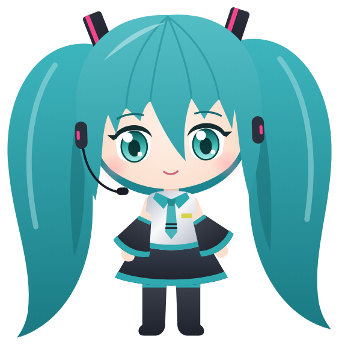
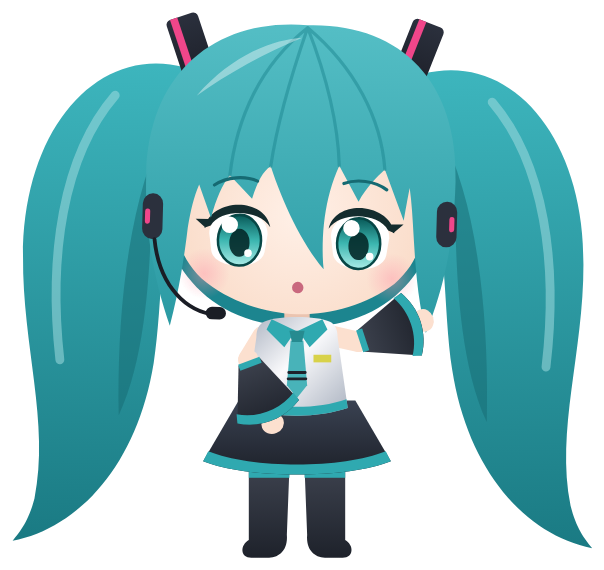
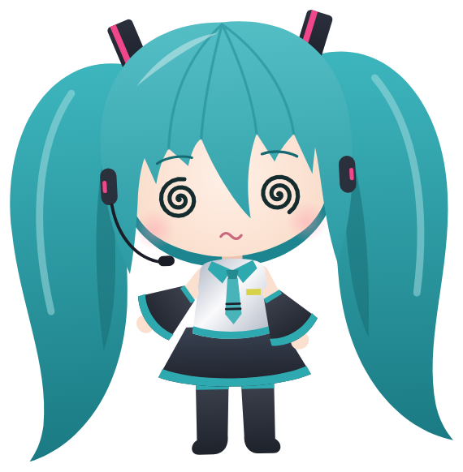
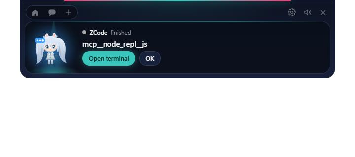
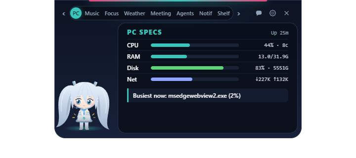
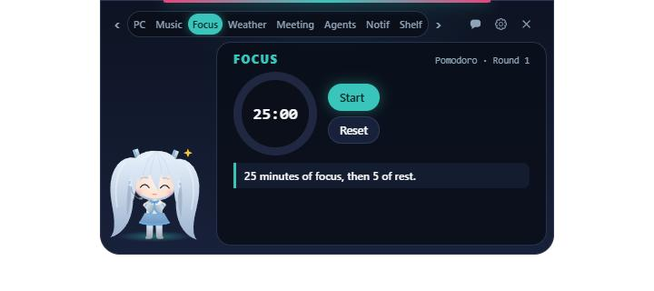
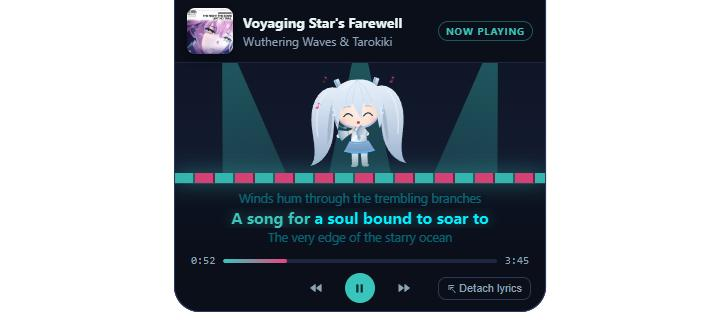
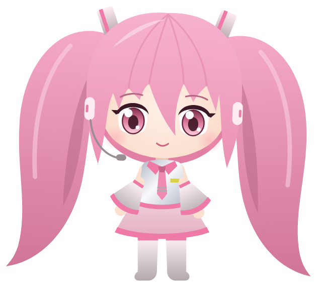
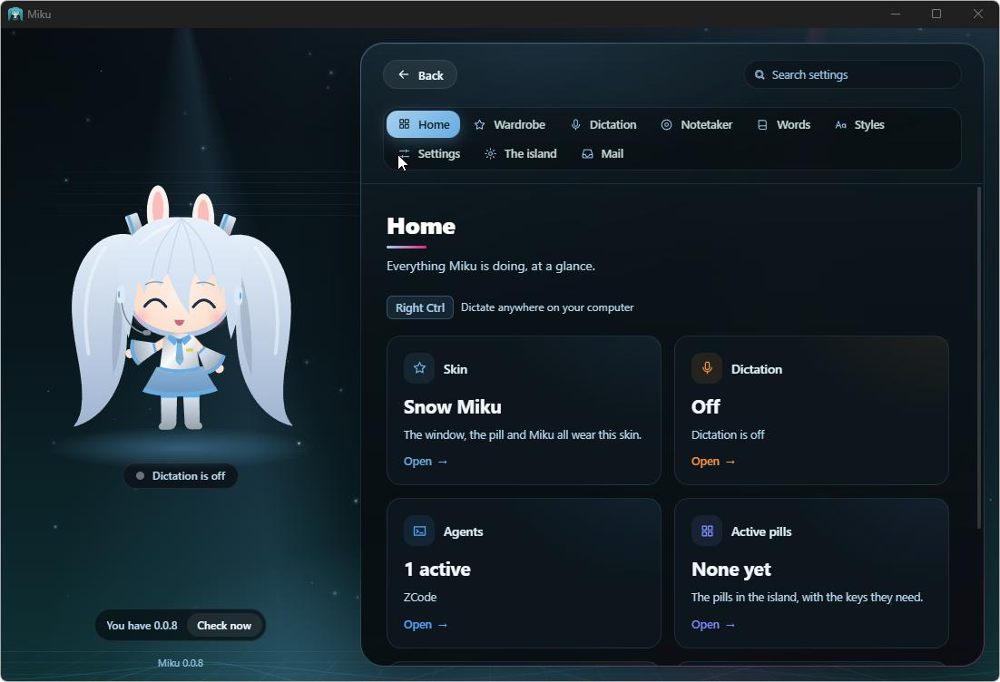

<div align="center">



# Miku

### Your AI agents, one glance away. Hatsune Miku on top of your screen.

Miku lives in a small island at the top of your screen on **Windows and Linux**. She tells you the second Claude Code needs you, lets you approve without switching windows, types what you say in any app, and sings along to your music.

[](https://github.com/FinDArata/Miku/releases)


**[⬇ Download for Windows](https://github.com/FinDArata/Miku/releases/download/windows-latest/Miku-Windows-setup.exe)** · **[Linux builds](https://github.com/FinDArata/Miku/releases)** · **[Build from source](#build-from-source)**


</div>

---

## Why Miku

- **Stop babysitting the terminal.** Run Claude Code, Codex, Cursor or Gemini in the background. Miku shows you when they're working, done, or waiting on you.
- **Approve without leaving your work.** Allow / Deny / Always, or answer an `AskUserQuestion`, right from the island. Nothing is approved without your click.
- **Talk instead of type.** Hold a key anywhere, speak, let go: your words are pasted. Offline.
- **Private by design.** No telemetry, no account. Keys stay in your OS keychain.
- **And she's cute.** Drawn entirely in code, she blinks, follows your cursor, dances to your music and waves when you come back.

## Your agents, at a glance

Miku's mood is your agents' status. You know what's going on without opening a single terminal.

<table>
<tr>
<td align="center"><br><sub>working</sub></td>
<td align="center"><br><sub>needs your OK</sub></td>
<td align="center"><br><sub>done!</sub></td>
<td align="center"><br><sub>nothing running</sub></td>
<td align="center"><br><sub>poked three times</sub></td>
</tr>
</table>

- 🤖 **Works with the agents you already use**: Claude Code, Codex, Cursor, Gemini CLI, Antigravity, Copilot CLI, Muse Code, OpenCode, Amp, Hermes, ZCode, Claude Desktop, and any other through a hook flag ([`docs/AGENTS.md`](docs/AGENTS.md)).
- 📋 **The Agents page**: the step each agent is on and for how long, the tail of the last tool output, Claude Code's task list, and every edit with its +N −M counts and the full diff one click away.
- ✅ **Approvals in a stack**: several requests wait their turn. Fold one away with Escape and it keeps waiting under the capsule until you answer.
- 🗣️ **She says who's done**: クロード、できたよ！ when Claude finishes, これ、いいかな？ when a permission comes in, in a VOICEVOX voice.
- 🌐 **Remote agents too**: agents on a server reach Miku through an SSH tunnel ([`docs/REMOTE.md`](docs/REMOTE.md)).

<table>
<tr>
<td align="center"><br><sub>an agent finishes — a card grows out of the capsule: <b>Open terminal</b> or <b>OK</b>, Miku watching over your session</sub></td>
</tr>
</table>

## The island

One island at the top of the screen that changes shape with what's going on:

| State | What you see |
|---|---|
| **Closed** | A small capsule: Miku's head and the time, or the date, your Claude usage, the weather or what's playing. It never pops open just because your pointer passes by. |
| **A notice** | A WhatsApp, LINE or Discord message, a finished agent or a new version grows a card out of the capsule. Unseen ones hang under it: Miku on a thread, holding a sign with the count. |
| **A song plays** | Her stage: cover, title, artist, Miku singing under the spotlights, and three lines of synced lyrics. |
| **Open** | The widget deck: **PC** stats, **Music**, **Focus** (pomodoro), **Weather**, **Meeting** (Cal.com), **Shelf** and **Agents**. |
| **An agent asks** | The approval card: Allow / Deny / Always, or the question's choices. |

<table>
<tr>
<td align="center"><br><sub><b>Closed</b> — the capsule, with what's playing</sub></td>
<td align="center"><br><sub><b>Open</b> — the PC page, your busiest process included</sub></td>
<td align="center"><br><sub><b>Focus</b> — 25 minutes of focus, then 5 of rest</sub></td>
</tr>
</table>

## Talk to your computer

- 🎙️ **Flow dictation**: hold right Ctrl (or any shortcut you pick) in any app, speak, let go. Runs **offline** with Parakeet, on Windows and on Linux (X11 and Wayland).
- ✍️ **Styles**: Claude cleans up what you said in the tone of the app you're typing in.
- 📖 **Dictionary and snippets**: names Miku must always spell right, and triggers that paste a whole block of text.
- 📝 **Notetaker**: your calls transcribed speaker by speaker, with a summary, key points and to-dos. No bot joins the meeting, and it all runs on your machine.
- 💬 **« OK Miku »**: ask her out loud to play music, check the weather, add a pill or draft an email.
- 🤝 **Chat with Claude**: with your own API key, or **on the subscription you already pay for** through the official CLI (Claude Code, Codex, Gemini CLI, Antigravity, Cursor, Copilot, ZCode).

## Music, karaoke style

- 🎵 Spotify and system media right in the island. Miku dances to the song itself.
- 🎤 **Karaoke lyrics**: synced lyrics in a floating card, the current line filling with teal in time with the song. Japanese and Korean can show as rōmaji.
- Lyrics only open for real songs, not for a YouTube Short.

<div align="center">



<sub>Her stage: cover, title, artist, three lines of synced lyrics — and Miku singing under the spotlights.</sub>

</div>

## Everything else she does

- 📎 **Drop a file on the island**: Miku catches it and puts it on the Shelf. Open it, reveal it, drag it back out, or ask Claude about it.
- ✉️ **Mail** *(Windows, classic Outlook)*: search, filters, VIP senders, sorting rules with Undo, and mail plans from the chat that only run when you click Run.
- 🔌 **Integrations**: GitHub, GitLab, Gitea, Vercel, Stripe, n8n, Resend, Notion, Cal.com and WhatsApp (experimental), each with its own pill.
- 💌 **LINE and Discord** *(Windows, off by default)*: their notifications show in the island, read from the toasts Windows already shows. Nothing is sent anywhere.
- 🔔 **A sound per notice**: pick Miku's voice, another of her sounds, silence, or your own file for each app.
- 🖥️ **Miku on the desktop**: drag her out of the island and she floats on your desktop, then flies home when something needs you.
- 📊 **Weekly recap**: what your agents got done this week, as a stage panel you can share.
- ⌨️ **Keyboard shortcuts** for everything, all customisable.
- 🔊 **30 sounds composed in code**. Drop a file with the same name in the sounds folder to replace any of them.
- 🌍 **14 languages**, Bahasa Indonesia included.
- 🔄 **One-click updates**: a new version comes down from the notch as a card. **Update now** checks the installer's SHA-256 against GitHub's before installing.

## Three looks, three themes

She comes in her three official looks, and **each look themes the whole app**: the island's stage light, the tabs, the buttons, the dictation pill and the Miku window. Pick one in the wardrobe (right-click Miku), or let the season choose: Snow in winter, Sakura in spring.

<table>
<tr>
<td align="center" width="33%"><br><b>Miku</b><br><sub>teal twin-tails, notes around her</sub></td>
<td align="center" width="33%"><br><b>Snow Miku</b><br><sub>falling snowflakes</sub></td>
<td align="center" width="33%"><br><b>Sakura Miku</b><br><sub>falling petals</sub></td>
</tr>
</table>

Every launch opens on a little concert: the footlights come on, a spotlight finds her mark, she rises through the stage floor and greets you (a wave, a bow or a twirl, different each day) while her name lights up karaoke-style.

<table>
<tr>
<td></td>
<td></td>
</tr>
</table>

## Install

### Windows

Download **[Miku-Windows-setup.exe](https://github.com/FinDArata/Miku/releases/download/windows-latest/Miku-Windows-setup.exe)** or **[Miku-Windows.msi](https://github.com/FinDArata/Miku/releases/download/windows-latest/Miku-Windows.msi)** (Windows 10/11, always the newest version) and run it.

> **SmartScreen warning?** The installer isn't code-signed yet, so Windows shows *"Windows protected your PC"*. Click **More info**, then **Run anyway**.

### Linux

x86_64 builds are on the [releases page](https://github.com/FinDArata/Miku/releases): AppImage, .deb and .rpm, with `SHA256SUMS`.

- **AppImage** (any distribution): `chmod +x Miku-Linux-*.AppImage`, then run it.
- **Debian / Ubuntu**: `sudo apt install ./Miku-Linux-*.deb`
- **Fedora / openSUSE**: `sudo dnf install ./Miku-Linux-*.rpm`
- **Arch**: build it with the [PKGBUILD](linux/arch/PKGBUILD).

The island sits on the top edge on compositors with layer-shell (COSMIC, KDE Plasma, Hyprland, Sway and other wlroots compositors). GNOME has no layer-shell, so there it runs through XWayland as a dock window at the top of the screen.

### Build from source

Requirements: [Rust](https://rustup.rs), Node 20+, and on Windows the MSVC build tools.

```bash
git clone https://github.com/FinDArata/Miku.git
cd Miku/windows
npm install
npm run tauri dev           # run it
npm run pack                # or build the installer into windows/release/
```

On Linux, install the WebKitGTK, gtk-layer-shell and appindicator development packages first (Debian/Ubuntu names):

```bash
sudo apt install build-essential pkg-config libwebkit2gtk-4.1-dev libgtk-layer-shell-dev libayatana-appindicator3-dev librsvg2-dev libssl-dev libdbus-1-dev patchelf gstreamer1.0-plugins-base gstreamer1.0-plugins-good
```

More in [`windows/README.md`](windows/README.md).

## Connect your agents

Click the Miku icon in the system tray → **Settings…**

| Agent | How it connects |
|---|---|
| Claude Code | Settings → Claude Code → **Install hooks** (your `settings.json` is backed up and you see the diff before anything is written) |
| Gemini CLI, Antigravity, Codex | Settings → the agent → **Install hooks** |
| Cursor | Installed alongside Claude Code |
| Copilot CLI, Muse Code | `--agent copilot` / `--agent muse` flag |
| OpenCode, Amp, Hermes | Settings → the agent → **Install** (a plugin that starts the `miku-hook` relay) |
| ZCode | Settings → Agents → ZCode → **Install** |
| Any other | `--agent <name>` flag; see [`docs/AGENTS.md`](docs/AGENTS.md) |

<table>
<tr>
<td align="center"><br><sub>The Miku window — every corner of her at a glance, her agents included.</sub></td>
</tr>
</table>

## Things to try

| Do this | Miku does that |
|---|---|
| Click the strip at the top of the screen | opens her stage |
| Press Escape | folds back to the strip |
| Hover Miku | blinks, eyes grow |
| Click Miku | squish + annoyed |
| Click 3 times fast | 😵‍💫 dizzy for a few seconds |
| Swipe or press ← / → on the overview | the next pill's slide, with a little "mi-ku" |
| Drag a file onto the island | she catches it |
| Right-click Miku | the wardrobe: classic, Snow or Sakura |
| Hold right Ctrl and speak, in any app | your words are pasted |

## Privacy

- **No telemetry, no account.** Nothing about you leaves your machine unless you plug in a service.
- **Keys stay in your OS keychain**: Windows Credential Manager or the Linux Secret Service, never on disk.
- **Dictation and the Notetaker run offline** once their models are downloaded.
- **Updates are opt-in**: Miku only asks GitHub's releases API about new versions after you agree.
- **Never blocks your agent**: if Miku doesn't answer, the hook exits at once.

## How it works

- A [Tauri 2](https://tauri.app) app (Rust + TypeScript). The island is a transparent, always-on-top window that never steals focus; on Wayland it is a gtk-layer-shell overlay.
- Miku is drawn in Canvas 2D by [`windows/src/mochi/engine.ts`](windows/src/mochi/engine.ts); her three looks are palettes in [`variants.ts`](windows/src/mochi/variants.ts). The app icon and every picture in this README are renders of that same engine.
- Agent hooks go through a tiny `miku-hook` relay, over the named pipe `\\.\pipe\miku-<sid>` on Windows or a Unix socket in `$XDG_RUNTIME_DIR` on Linux.

## License

- **Miku's brand, icon and sounds** belong to this build's owner — see [LICENSE](LICENSE).
- **Hatsune Miku** is © Crypton Future Media, INC., used under the [Piapro Character License](https://piapro.net/en_for_creators.html). This build is non-commercial and is not official, sponsored or endorsed by Crypton Future Media. The chibi here is drawn by this project's own code; no official artwork is included.

<div align="center">

**If Miku made you smile, a ⭐ helps a lot.**

</div>
